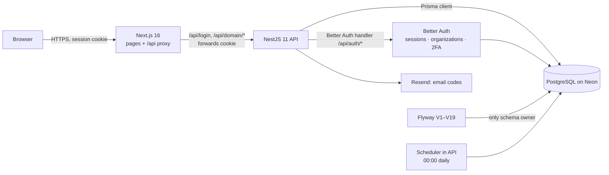
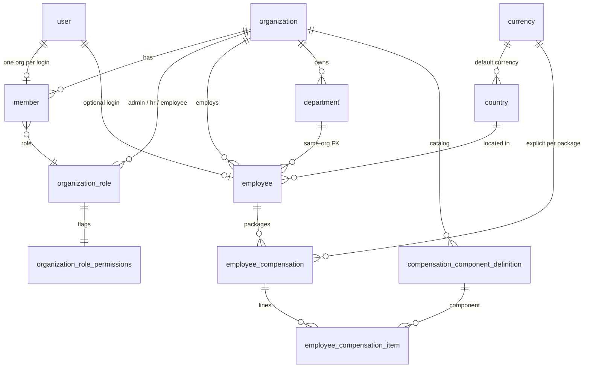
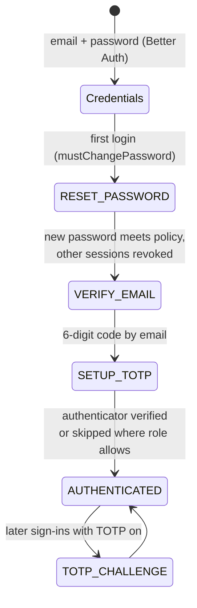
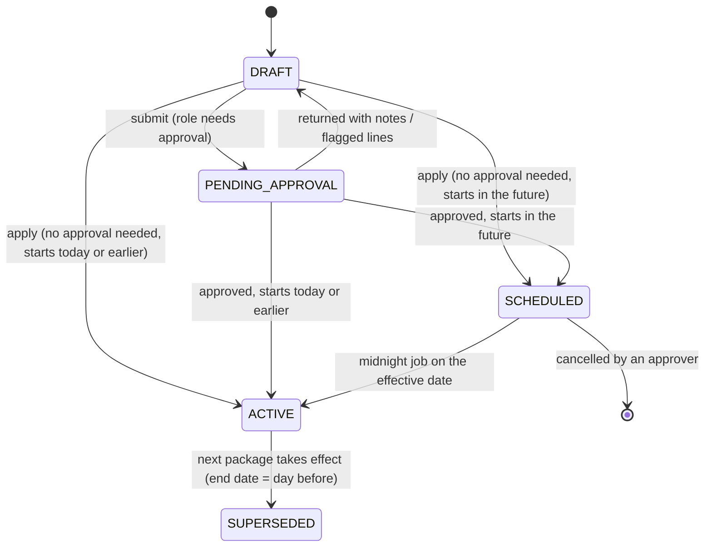

# CompVista: Product & Engineering Decisions (Final)

**Status:** Final for submission · **Last updated:** 23 November 2026
**Sources:** consolidates the *Product Decisions & Rationale* log (PD-001 to PD-057) and the *Technical & Architecture Decisions* log (ADR-001 to ADR-065), checked against the code as built. Where the two logs and the code disagree, **the code is the source of truth**, and the change is recorded in [§8 How the plan changed](#8-how-the-plan-changed-superseded-decisions) with the reason.

---

## Contents

1. [One-page summary](#1-one-page-summary)
2. [Who it is for and the questions it answers](#2-who-it-is-for-and-the-questions-it-answers)
3. [Scope: built, deliberately left out, and why](#3-scope-built-deliberately-left-out-and-why)
4. [Architecture](#4-architecture)
5. [How it works](#5-how-it-works)
6. [Final decision register](#6-final-decision-register)
7. [Quality: tests, performance, security](#7-quality-tests-performance-security)
8. [How the plan changed (superseded decisions)](#8-how-the-plan-changed-superseded-decisions)
9. [Known limitations and next steps](#9-known-limitations-and-next-steps)
10. [How AI was used](#10-how-ai-was-used)
11. [Runbook](#11-runbook)

---

## 1. One-page summary

**Problem.** ACME's HR team manages salaries for about 10,000 employees in several countries using spreadsheets. Spreadsheets have no history, no controls on who changes what, no safe way to compare pay across currencies, and no quick way to answer "how do we pay people?".

**Goal.** A web application where the **HR Manager** can find anyone in seconds, see and revise their compensation with a full history and an approval step, and answer organization-wide pay questions correctly.

**What we built.**

| Area | What it does |
|---|---|
| People directory | Server-side search, filters (department, country, currency, salary range, role, package status), sorting and pagination over 10,000 people |
| Compensation packages | Packages built from components (Basic, HRA, allowances, employer contributions, deductions, bonuses), each with a payment frequency, effective dates, and immutable history |
| Controlled revisions | Maker-checker approval. HR proposes; Admin approves or returns it with line-by-line feedback. Future-dated changes wait as **Upcoming** and switch over at midnight |
| Analytics | Dashboard and Insights: spend, average and median, salary bands, department and country breakdowns, a department × country matrix, cost composition. **Amounts in different currencies are never added together** |
| Organization structure | Departments per organization, countries with a default currency, job titles and levels, employment status |
| Access | Three roles (Admin, HR, Employee) with per-organization permission flags, enforced by the backend. Employees see only their own pay |
| Sign-in | Better Auth email and password, then forced password change, email verification by code, and authenticator-app TOTP (required or optional per role) |
| Data and demo | Deterministic 10,000-employee seed, plus an operator-only page that creates a complete organization with a login for every person and a credentials CSV |

**Deliberately left out:** payroll runs, tax, payslips, currency conversion, salary-trend charts, spreadsheet import, enterprise SSO, multiple languages, and an in-product AI assistant. Reasons are in §3.

**Stack:** Next.js 16 (React 19, Tailwind v4) · NestJS 11 · PostgreSQL on Neon · Prisma 7 (queries only) · Flyway (the only tool that changes the schema) · Better Auth (sessions, organizations, two-factor).

---

## 2. Who it is for and the questions it answers

**Primary persona: the HR Manager (PD-001).** Everything is designed around their day: find a person → understand their pay → change it safely → explain it later → report on it.

| Persona | Role in the app | What they can do |
|---|---|---|
| HR Manager / Compensation Admin | `admin` | Everything in their organization: propose, approve, apply directly, cancel upcoming packages, manage components and departments |
| HR team member | `hr` | View all compensation, propose changes for others (needs approval), cannot propose changes to their own pay |
| Employee (including HR staff, as themselves) | `employee` | See only their own current and past packages |

**Questions the product answers on screen.** These are the "how does the org pay people" questions from the brief:

1. What do we spend per year on pay, in each currency? *(Dashboard: total CTC, per-currency totals)*
2. What does a typical person earn, and how wide is the spread? *(average, median, range, salary-band histogram)*
3. Which departments and countries cost the most, and how many people are there? *(department bars, country breakdown, department × country matrix)*
4. What is the cost made of? *(gross earnings vs employer contributions per component; deductions shown separately)*
5. Who is in a given salary band, department or country? *(click through from any chart to the filtered directory)*
6. What is waiting for approval, and for how long? *(approvals panel with age buckets)*
7. What did this person earn before, what changed, when, and who approved it? *(package history, approval notes)*

---

## 3. Scope: built, deliberately left out, and why

### In scope

| Feature | Why it is in |
|---|---|
| Server-side directory for 10,000 people | The brief's scale makes client-side tables unusable (PD-005, ADR-008) |
| Component-based packages with payment frequencies | Real pay is not one number: monthly basic, percentage allowances, annual bonuses, employer contributions |
| Effective-dated, immutable history | "History matters as much as the latest value" (PD-007). Spreadsheets lose it |
| Maker-checker approvals | Salary is sensitive. Nobody below Admin should change pay alone (PD-045) |
| Line-by-line "return for changes" | Feedback on a specific component, or on the date, saves a round trip compared with a free-text "please fix" |
| Upcoming packages and the midnight switch-over | A raise approved today for next month must not show as current today |
| Native-currency analytics with no conversion | Converting with invented exchange rates would make comparisons look precise when they are wrong (PD-006) |
| Departments, countries, titles, levels | Needed for every useful pay question (by team, by location, by seniority) |
| Login for every employee, self-view only | The brief's persona is HR, but staff seeing their own pay is low-cost and demonstrates that permissions work |
| Multiple organizations, isolated | B2B by nature. Proving one organization cannot see another's data is a strong correctness signal (PD-022) |
| Forced password change, email code, TOTP | Generated credentials must not grant lasting access (PD-026, PD-056) |

### Deliberately left out

| Excluded | Why |
|---|---|
| Payroll runs, tax, statutory filings, bank transfers, payslips | A different product with heavy compliance scope. We manage *compensation*, not *payroll* (PD-004, PD-011) |
| Currency conversion / FX rates | No trustworthy rate source or policy was agreed. Totals stay in their own currency and the UI asks the user to pick one (PD-006 resolved this way) |
| Salary-trend and raise-history charts | Seed data has a single package per person, so trends would be invented numbers |
| Spreadsheet import | Valuable for migration, but validation design (bad rows, partial failures) is a project in itself. Listed as the first follow-up |
| Reporting lines (manager tree) | Not needed to answer the brief's pay questions. Departments, levels and countries cover the analysis (ADR-032/040 deferred) |
| Enterprise SSO, social login | No identity provider to test against; social login is wrong for an HR tool (PD-016, PD-017) |
| Forgot-password by email | First-login password change is built. Self-service reset depends on trusted inboxes, and demo inboxes are public (see §7) |
| Marketing site, public home page | No value for the persona. `/` goes straight into the app or to sign-in (PD-002) |
| Multiple languages | Text and number formatting stay in one place so this can be added later (PD-012) |
| In-product AI assistant | A trustworthy baseline first. AI over salary data needs privacy and evaluation work (PD-013) |

---

## 4. Architecture



**Why this shape**

- **Modular monolith (ADR-002).** One NestJS service, one Next.js app, one database. 10,000 employees do not need microservices. One deployable backend keeps permission checks in one place.
- **Same-origin proxy.** The browser only talks to Next.js. Next.js forwards the session cookie to NestJS (`frontend/src/app/api/domain/[...path]/route.ts`), which accepts only an allowlist of top-level paths. This avoids cross-origin cookie and CORS problems (ADR-026, ADR-050).
- **Database sessions, not JWTs (PD-043, ADR-050).** Logging out, changing a password, or losing a role takes effect immediately.
- **Flyway owns the schema (ADR-044).** Constraints, triggers and partial indexes are written as reviewed SQL. Prisma only reads the schema and generates a typed client. Nothing changes the schema at startup.
- **Business rules are also enforced in the database.** Applied packages cannot be edited, one active package per employee, no overlapping applied periods, a department must belong to the employee's organization. The application cannot break these even with a bug.

**Code map**

| Area | Backend (`backend/src`) | Frontend (`frontend/src`) |
|---|---|---|
| Auth gate | `access.controller.ts`, `totp-policy.ts`, `email-otp.*`, `totp.controller.ts`, `auth.ts` | `app/login/*`, `components/auth/*`, `app/app/layout.tsx` |
| Permissions | `compensation-access.ts`, `compensation-workflow.ts` | `app/app/(manage)/layout.tsx`, `components/sidebar-demo.tsx` |
| Compensation | `compensation.controller.ts`, `compensation-calculation.ts`, `compensation-scheduler.service.ts` | `components/compensation/*` |
| Directory, departments, profiles | `workforce.controller.ts` | `components/compensation/directory.tsx`, `departments.tsx`, `profile-card.tsx` |
| Analytics | `analytics.ts`, `analytics.controller.ts` | `components/analytics/*`, `components/flag.tsx` |
| Seed and provisioning | `workforce-plan.ts`, `provisioning.ts`, `provisioning.controller.ts` | `app/provision`, `components/provision/*` |
| Schema | `db/migration/V1…V19`, `prisma/schema.prisma` | — |

---

## 5. How it works

### 5.1 Data model



Key rules and where they are enforced:

| Rule | Enforced by |
|---|---|
| One organization per login (PD-041) | `UNIQUE(member.userId)` (V1) |
| Every member has its organization's role row | `member_role_sync` trigger (V3) |
| An employee's department belongs to the same organization | Composite foreign key `(departmentId, organizationId)` (V19) |
| One `ACTIVE` and at most one `SCHEDULED` package per employee | Partial unique indexes (V9, V17) |
| Applied periods never overlap | `EXCLUDE USING gist` on `daterange(effective_from, effective_to)` (V9) |
| Applied packages are immutable; only drafts and upcoming packages can be deleted | `compensation_package_guard` trigger (V11, V17) |
| Basic Salary is fixed, positive and monthly | Item trigger + calculator (V12) |
| A component used by a live package cannot be deactivated; deleted components stay readable | `compensation_definition_guard` (V15, V17) |
| A country's default currency never overwrites a package's currency | Currency is a column on each package, not looked up from the country |

### 5.2 Signing in (PD-026, PD-056, ADR-062–064)



- The next step is computed **on the server** by `nextAuthStep()` (`totp-policy.ts`). `/app` (`app/app/layout.tsx`) and every compensation endpoint call `GET /api/access`, which rejects anything short of `AUTHENTICATED`. A partly signed-in session can never read pay data.
- **Password policy:** at least 10 characters with upper case, lower case, digit and symbol (`password-policy.ts`).
- **Email codes:** stored only as a hash, valid for 10 minutes, at most 5 attempts, 60 seconds between resends, and tied to the address they were sent to (V6, V7).
- **TOTP** uses Better Auth's two-factor plugin (secrets, backup codes, challenges). Whether it is required is a per-role flag, `requireTotp` (V8). It is **off by default** so a reviewer can get in; turn it on for a real deployment (see §8, PD-026).
- **No public sign-up and no organization creation** through Better Auth outside seeding (`auth.ts`: `disableSignUp`, `disabledPaths`) (ADR-061).

### 5.3 Permissions (PD-044 to PD-051, ADR-051 to ADR-058)

Three fixed roles. Each organization stores **typed boolean flags** per role (`organization_role_permissions`, V3/V4; columns, not JSON, per PD-051):

| Flag | Admin | HR | Employee |
|---|:-:|:-:|:-:|
| `canViewAllComp` | ✓ | ✓ | — |
| `canViewOwnComp` | ✓ | ✓ | ✓ |
| `canProposeOthersComp` | ✓ | ✓ | — |
| `canProposeOwnComp` | ✓ | — | — |
| `canApproveComp` | ✓ | — | — |
| `canApproveOwnComp` | ✓ | — | — |
| `requiresApproval` | — | ✓ | ✓ |
| `requireTotp` | — | — | — |

- **Admin is a superuser in its own organization (PD-048, ADR-055).** It always keeps propose and approve rights, so a single-admin organization always works.
- **Separation of duties** (`compensation-workflow.ts`). HR cannot propose changes to their own pay. Nobody approves their own pay unless `canApproveOwnComp` allows it. Someone who needed approval cannot approve their own submission.
- **The employee role never gets organization-wide access,** whatever its flags say (`compensation-access.ts`).
- **Every query is scoped to the caller's organization,** taken from the session, never from the request.

### 5.4 Compensation calculation

`compensation-calculation.ts` is the single calculator, used by the API, the seed and provisioning:

- Each item is **fixed** or a **percentage of Basic**. Amounts are **per payment**, with a frequency: monthly ×12, quarterly ×4, three times a year ×3, half-yearly ×2, annual ×1, one-time (outside CTC).
- **Annual CTC = annualized earnings + annualized employer contributions.** Employee deductions (for example Employee PF) are reported separately and **never added to CTC**.
- Decimal arithmetic throughout (`Prisma.Decimal`), rounded half-up to the currency's decimal places. Per-item `resolved_amount` and `annual_amount` are stored, so reports re-add stored values instead of recalculating (ADR-010).

### 5.5 Package lifecycle and approvals (PD-045, ADR-052)



- **Pending changes never alter current pay.** On approval, the previous package's end date is set to the day before the new one starts, inside one transaction that locks the employee row.
- **Line-by-line feedback** (V18). The approver flags individual components or the effective date, each with a note. The proposer sees them on the draft and next to each flagged row in the editor. The flags clear on resubmission.
- **Upcoming packages** (V16, V17). One per employee. `CompensationSchedulerService` promotes due packages at 00:00 and once at startup, so a missed midnight is caught up. Promotion locks the employee row and re-checks status, so running it twice is safe.
- **Concurrency.** Drafts and pending packages carry a `version`. Edits and decisions use compare-and-set, so stale screens get "this changed, reload" instead of overwriting someone else's change.
- **Audit trail.** Every package records `created_by`, `submitted_by/at`, `decided_by/at`, `decision_note` and `change_requests`. Superseded packages stay readable as history.

### 5.6 Directory and analytics (PD-005, PD-006, ADR-008, ADR-010)

- **Directory** (`workforce.controller.ts`). One SQL query per page. Packages are grouped into one row each first, then joined to people. Search covers name, email, code and title; filters cover role, status, department, country, currency and a salary range (salary range only with a currency).
- **Analytics** (`GET /compensation/analytics`, `analytics.ts`). One endpoint returns everything for a set of filters (country, department, currency). Rules:
  - **Never sum across currencies.** Money appears only when exactly one currency is in scope. Otherwise the response carries totals per currency and `requiresCurrency: true`, and the UI asks for a choice. Selecting a country does **not** convert or replace package currencies.
  - **Grouping by package before joining** prevents totals being multiplied by item rows.
  - **Median and average are per employee.** For an even count, the median is the mean of the two middle values, computed exactly in SQL.
  - **Salary bands** use round steps (1, 2, 2.5 or 5 × 10ⁿ). Each band includes its lower bound and excludes its upper bound. Clicking a band opens those people in the directory.
  - **Cross-filtering.** The department chart ignores the department filter and the country chart ignores the country filter, so the selected item is highlighted with the others still visible. The department × country matrix always shows the whole organization.
- **UI** (`components/analytics/*`). Filters live in the URL, so Dashboard and Insights share them and links can be shared. Charts are hand-built with SVG and CSS, so no charting dependency is needed. Every bar is a keyboard-reachable button with an accessible label. Flags are small inline SVGs, and only ISO codes are stored.

### 5.7 Seeding and provisioning (PD-023 to PD-025, PD-052 to PD-054, ADR-029 to ADR-032, ADR-059)

**Workforce plan** (`workforce-plan.ts`, pure and deterministic):

- **Exact totals.** Country targets (IN 5,000 · US 1,500 · GB 1,000 · DE 1,000 · AE 800 · SG 700) and department targets (Engineering 3,500 · Sales & Marketing 1,800 · Operations 1,700 · Product 1,200 · Finance 1,000 · HR 800) are met exactly at any size. Cross-tabulation uses iterative proportional fitting on a realistic affinity table (engineering hubs in India and Germany, sales in the US, UK and UAE), followed by controlled rounding.
- **Deterministic generation.** A fixed random seed produces names (synthetic per-country pools), levels, titles, hire dates and status.
- **Country-appropriate packages.** PF only in India. Retirement, health insurance, housing and bonus components elsewhere. Every package goes through the real calculator.

**Two ways to create data:**

| | `npm run seed:workforce` | `/provision` page · `npm run org:create` |
|---|---|---|
| Purpose | Grow an existing org to exactly 10,000 records | Create a complete new org from scratch |
| Logins | Only existing seeded accounts | **One login per person** (admins, HR, employees), 100–20,000 total |
| Idempotent | Yes: inserts only missing roster codes | Refuses an existing slug. Removes everything it created if a step fails (not if the server process is killed mid-run; reset with `db:reset-dev`) |
| Output | Validation report | Credentials CSV of temporary passwords |

**Provisioning safety** (PD-024, PD-025, ADR-029, ADR-030):

- **Access.** Disabled unless the server has `COMPVISTA_PROVISIONING_KEY`. Every call must send that key, compared in constant time. Creation is a `POST`; viewing the page changes nothing.
- **Runs as a background job.** One job at a time, with progress and an estimated time left. Passwords are hashed with Better Auth's own scrypt function on a larger thread pool (`threadpool.ts`). 10,000 accounts take a few minutes.
- **Credentials.** Passwords are random, satisfy the password policy, and are stored **only as hashes**. The CSV is held **in memory for 30 minutes**, sent `no-store`, and cells that look like spreadsheet formulas are neutralized. Every account starts with `mustChangePassword`.

---

## 6. Final decision register

Status key: **Final** = built as decided · **Changed** = built differently (see §8) · **Deferred** = intentionally not built · **Superseded** = replaced.

| ID | Decision | Status | Where |
|---|---|---|---|
| PD-001 | HR-first application | Final | Navigation, directory, approvals |
| PD-002 / ADR-005 | No marketing or public home page | Final | `app/page.tsx` redirects to `/app` |
| PD-004 | Compensation management, not payroll | Final | §3 |
| PD-005 | Works at 10,000 employees | Final | SQL directory and analytics, §7 |
| PD-006 / ADR-010 | Native currency; no silent conversion | Final (no FX at all) | `analytics.ts` |
| PD-007 / ADR-011 | Effective-dated, immutable history | Final | V9, V11, V17 |
| PD-008 / ADR-006 | ReUI-first components | Changed | §8 |
| PD-009 / ADR-007 | Teal/jade brand, Manrope + Inter | Final | `globals.css`, brand kit |
| PD-010, PD-011 / ADR-013 | Employee document requests, payslips | Deferred | §3 |
| PD-012 / ADR-015 | Multilingual later | Deferred | §3 |
| PD-013 | In-product AI agent | Deferred | §3 |
| PD-016, PD-017 / ADR-022 | No social login; SSO later | Final / Deferred | `auth.ts` |
| PD-018, PD-027 | Root goes to sign-in, not `/signup` | Final: `/` → `/app` → `/login` | `app/page.tsx`, `app/app/layout.tsx` |
| PD-021 / ADR-025 | Better Auth, not Clerk | Final | `auth.ts` |
| PD-022 / ADR-028 | Multi-tenant, shared schema, organization-scoped | Final | Every query, composite foreign keys |
| PD-023 / ADR-032 | Reproducible 10,000-employee synthetic org | Final | `workforce-plan.ts` |
| PD-024 / ADR-029 | Protected provisioner, POST only, job and progress | Changed (key, not emailed link) | `provisioning.controller.ts` |
| PD-025 / ADR-030 | Credentials CSV, passwords never stored | Changed (30-minute re-download) | §8 |
| PD-026 / ADR-027 | Password change, then TOTP before access | Changed (TOTP required per role) | `totp-policy.ts` |
| PD-031, PD-032 / ADR-037, ADR-038 | Emailed one-time evaluator link | Superseded by PD-052, then by the provisioning page | §8 |
| PD-033 / ADR-039 | User, membership and employee are separate concepts | Final | `employee.userId` optional |
| PD-034 / ADR-040 | Org chart separate from permissions | Final (org chart deferred) | §3 |
| PD-041 / ADR-048 | One organization per login, Better Auth `member` kept | Final | V1 `UNIQUE(member.userId)` |
| PD-043 / ADR-050 | Database sessions, no JWTs | Final | Better Auth sessions |
| PD-044 / ADR-051 | Exactly three roles | Final | V3 check constraint |
| PD-045 / ADR-052 | Maker-checker salary changes | Final | §5.5 |
| PD-046 / ADR-053 | No HR self-proposal | Final | `canPropose` |
| PD-048 / ADR-055 | Admin superuser, can self-approve | Final | `flagsOf` in `compensation-workflow.ts` |
| PD-049 to PD-051 / ADR-056 to ADR-058 | Per-organization permission flags as typed columns | Final (storage); Deferred (admin edit API) | V3/V4 |
| PD-053, PD-055 | 9-account and 19-account dev seeds | Superseded by the 10,000-login provisioning | §8 |
| PD-056, PD-057 / ADR-062 to ADR-065 | Partial login never reaches data | Final | `GET /api/access` gate |
| ADR-002 | NestJS modular monolith | Final | `backend/` |
| ADR-003 / ADR-044 | PostgreSQL + Prisma; Flyway owns schema | Final | `db/migration`, `scripts/flyway.mjs` |
| ADR-008 / ADR-009 | TanStack Table, Recharts, TanStack Query | Changed | §8 |
| ADR-014 | Hosting | Final choice is the owner's at deploy time | README |

---

## 7. Quality: tests, performance, security

### Tests

| Suite | Count | What it proves | Speed |
|---|---|---|---|
| Backend unit (`npm test`) | 49 tests | Calculator (frequencies, rounding, deductions outside CTC, one-time outside CTC); permission and approval rules; upcoming-package date logic; change-request validation; workforce plan (exact totals at any size, determinism, local currency, PF only in India); salary bands and filter validation; provisioning limits, password policy, CSV formula neutralization; auth step machine; email-code rules | ~1.5 s, no database |
| Backend integration (`npm run test:integration`) | 5 suites | Against a Flyway-migrated validation branch: organization isolation, immutable history, conflicts; **analytics against a hand-calculated two-currency dataset** (median of an even count, deductions excluded, filters, isolation); provisioning creates working logins and **a generated employee signs in** with their CSV password; 10,000-employee performance smoke test | Needs `COMPVISTA_COMP_TEST_URL` or `COMPVISTA_ANALYTICS_SMOKE_URL` |
| Frontend (`npm test`) | 18 tests | Login form validation, login route mapping, reset, email verification, TOTP setup, domain proxy allowlist | ~3 s |

Tests that write data run on a disposable database branch, never on the shared dev database. Applied packages cannot be deleted by design, so test data on a shared database would be permanent.

### Performance (measured on Neon, 10,000 employees, 45,167 package lines)

| Operation | Time |
|---|---|
| Analytics, no filters (first request, includes connection) | ~1.3 s |
| Analytics, one currency | ~0.95 s |
| Analytics, India + Engineering | ~0.48 s |
| Directory page, sorted by CTC, one currency | ~0.14 s |
| `seed:workforce`, full 10,000 | ~29 s (batches of 500, one transaction each); re-run ~3 s, inserts 0 |
| Provisioning, 10,000 logins | ~2–3 min, dominated by password hashing |

What makes this fast: SQL aggregation instead of loading rows into Node; partial indexes on active packages (`organization_id, currency_code, employee_id WHERE status = 'ACTIVE'`) and pending approvals; indexes on employee `(organizationId, departmentId)` and `(organizationId, countryCode)`; batched `createMany` instead of 10,000 individual round trips.

### Security summary

- Server-side authorization on every endpoint: session → membership → role flags → organization scope.
- Pay is never exposed to the employee role beyond their own applied packages. Drafts and pending items are never shown to them.
- **Defense in depth** with database constraints and triggers (immutability, overlap, same-organization foreign keys).
- Secrets stay out of the repo (`.env` is git-ignored). The credentials CSV is never written to the database or logs.
- **Known demo trade-off:** generated accounts use `yopmail.com` addresses, whose inboxes are public. That's acceptable only because all data is synthetic (PD-028, ADR-034). Production should use a controlled mail domain and turn on `requireTotp`.

---

## 8. How the plan changed (superseded decisions)

Recorded so the history stays honest, as both logs' maintenance rules require.

| Planned | Built | Why |
|---|---|---|
| Clerk for authentication (PD-014, ADR-004, ADR-017 to ADR-023) | Better Auth (PD-021, ADR-025) | Clerk's production MFA is a paid feature; Better Auth gives email/password, TOTP and backup codes on our own Postgres |
| Users may belong to many organizations (PD-038, ADR-045) | One organization per login (PD-041, ADR-048) | Simpler tenancy; Better Auth `member` table kept for compatibility |
| Separate HR Admin / HR Viewer / Owner roles (PD-034, ADR-040) | Admin / HR / Employee (PD-044) | Three fixed roles plus per-organization flags cover the needs without a role builder |
| Admin cannot self-approve (PD-046, ADR-053) | Admin is a superuser (PD-048, ADR-055) | A single-admin organization must be able to operate |
| Permission policy in its own table with `GET/PATCH /admin/access-policy` (PD-050, ADR-057) | Typed flags in `organization_role_permissions`; no edit API yet | Storage decision kept (columns, not JSON); the edit screen was cut for time. Flags are set at seed or provisioning time |
| ReUI components, TanStack Table, Recharts (PD-008, ADR-006, ADR-008, ADR-009) | Tailwind v4 components built in-repo, Aceternity aurora and sidebar, SVG/CSS charts | The few components needed were quicker to build than to adapt. Avoided a charting dependency; all data stays server-paginated |
| TOTP mandatory for everyone (PD-026, ADR-027) | Required per role via `requireTotp`; otherwise the user may enroll or explicitly skip | Evaluators must be able to get in without an authenticator app. The flag turns it back on per role with no code change |
| Emailed one-time evaluator link with 2–3 real invitees (PD-031, PD-032, ADR-035, ADR-037) | Superseded first by the script-only seed (PD-052), then by an operator page with a server key | No email-grant infrastructure was needed for a single-operator demo. The page still follows PD-024's guardrails: POST only, key never in the URL, disabled unless configured |
| 10,000 employees as records, 20 HR logins only (ADR-032) | Every person gets a login | The owner chose to demonstrate employee self-service at full scale |
| Accounts created through Better Auth's admin APIs (ADR-030) | Bulk inserts using **Better Auth's own `hashPassword`** | 20,000 individual sign-up calls would take far too long. The integration test proves a generated password signs in through Better Auth |
| CSV downloadable exactly once (PD-025, ADR-030) | Re-downloadable for 30 minutes, then purged from memory | A failed browser download would otherwise lose every password. Still never persisted |
| Reporting lines with `managerEmployeeId` (PD-023, ADR-032, ADR-039, ADR-040) | Not built | Not needed for the brief's pay questions; deferred |
| Root redirects to `/signup` (PD-018, ADR-018) | `/` → `/app` → `/login` (PD-027 recommendation adopted) | No public sign-up exists, so sign-in is the only sensible entry |

---

## 9. Known limitations and next steps

1. **Spreadsheet import and export.** HR lives in Excel today. Export of the filtered directory is the quickest win; import needs a validation and preview step.
2. **Permission editing screen** (PD-050). Flags exist and are enforced; Admins cannot edit them in the UI yet.
3. **Self-service password reset** with a controlled mail domain.
4. **Reporting lines and pay bands per level** (compa-ratio, min/mid/max per level and country).
5. **Profile edits are not audited** the way packages are; add an audit event table.
6. **Single API instance.** Provisioning jobs and the midnight timer live in that server's memory. Run one instance, or move both to a database-backed job table before scaling out.
7. **Analytics under a second at scale** would need a summary table refreshed on package changes. Unnecessary at 10,000 people.

---

## 10. How AI was used

AI (Claude Code, among others) was used as a pair-programmer under explicit product direction (ADR-016). The owner set decisions in these two logs; AI implemented them in small, reviewed steps and was held to them.

- **Planning artifacts first.** Both decision logs were written before the related code, and AI was asked to challenge them. Examples: the Clerk MFA cost (ADR-024), the one-way risk of using a public URL as authorization (PD-024), YOPmail's public inboxes (PD-028).
- **Verification over trust.** Every feature was typechecked, linted and tested. Analytics was checked against a dataset whose expected values were calculated by hand. UI work was checked with real-data screenshots at several screen sizes.
- **Corrections made along the way, kept honest:**
  - Applying a package dated in the future made it "Current" immediately. That led to the Upcoming status and the nightly promotion job.
  - The old directory loaded every package into memory. It was rewritten as SQL before seeding 10,000 people.
  - The first compact INR format showed "₹1KCr". It was replaced with a lakh/crore formatter.
  - An existing integration test had silently broken after the approval workflow was added. It was found and fixed.
  - A dev server serving stale pages was diagnosed with a production build, not "fixed" in code.
- **Guardrails.** AI never ran destructive database operations without the owner's explicit instruction. Data-writing tests used disposable branches.

---

## 11. Runbook

```powershell
# Backend (backend/.env: DATABASE_URL, DIRECT_URL, BETTER_AUTH_SECRET, FRONTEND_URL, RESEND_API_KEY, NEON_BRANCH, COMPVISTA_PROVISIONING_KEY)
cd backend
npm install
npm run db:migrate            # Flyway V1–V19 (set FLYWAY_COMMAND if flyway is not on PATH)
npx prisma generate
npm run dev                   # http://localhost:4000

# Frontend
cd ../frontend
npm install
npm run dev                   # http://localhost:3000

# Create an organization with logins (either way)
#   UI:  http://localhost:3000/provision   (enter COMPVISTA_PROVISIONING_KEY)
#   CLI: $env:COMPVISTA_DEV_SEED='YES'; npm run org:create -- --name "ACME" --admins 3 --hrs 25 --employees 9972

# Tests
cd backend;  npm test         # unit, ~1.5 s
cd frontend; npm test
# Integration (disposable database only):
#   $env:COMPVISTA_COMP_TEST_URL='<branch url>'; npm run test:integration
```
